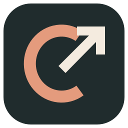

  

<h1 align="center">Claude Link</h1>

Claude Code 网络环境自动配置工具 · Windows / macOS

  <a href="https://github.com/slobys/ClaudeLink/releases/latest">下载最新版</a> ·
  <a href="docs/使用指南.md">使用指南</a> ·
  <a href="docs/macOS.md">Mac 安装指南</a>

## 项目用途

Claude Link 用来自动完成使用 Claude Code 前的网络与环境准备。首次保存好节点和偏好后，每次选择项目并启动，程序就会按预设配置网络、检查连接，再打开 Claude Code。

它把需要反复手动处理的步骤放到一次启动流程中：

- 配置网络：启动所选节点，建立本地代理或 TUN 虚拟网卡连接
- 应用环境：按设置临时关闭 IPv6、匹配出口时区，并为命令行和专用核对浏览器设置语言
- 检查并启动：检查网络出口与连通性，打开 Claude Code 命令行或官方桌面应用的 Code 页面
- 结束并恢复：结束会话后，根据恢复记录尝试还原本次临时设置

节点与订阅管理用于提供所需的网络连接，常用选项可以保存复用。需要系统授权或检查未通过时，程序会提示确认。

节点管理采用地区卡片，支持搜索、地区和分组筛选，单击即可选择。点击 **一键测速** 可查看当前筛选节点的 HTTP 延迟，并按延迟升降序排列；测速前请先断开连接。需要住宅 IP 或其他出口时，可创建双跳链式代理：**本机 → 入口节点 → 最终出口 → 目标网站**。先添加两个节点，再创建并选择该链路。

## 下载安装

当前版本为 **v1.4.1**，按电脑类型选择安装包：

| 你的电脑 | 下载 |
|---|---|
| Windows 64 位 | [EXE 安装包](https://github.com/slobys/ClaudeLink/releases/download/v1.4.1/ClaudeLink-Setup-1.4.1.exe) |
| Mac，Apple 芯片（M 系列） | [Apple 芯片 DMG](https://github.com/slobys/ClaudeLink/releases/download/v1.4.1/ClaudeLink-1.4.1-macos-arm64.dmg) |
| Mac，Intel 芯片 | [Intel DMG](https://github.com/slobys/ClaudeLink/releases/download/v1.4.1/ClaudeLink-1.4.1-macos-x64.dmg) |

Windows 下载后运行 EXE；Mac 打开 DMG，把应用拖入“应用程序”。不需要预装 .NET。便携版和其他版本见 [发布页](https://github.com/slobys/ClaudeLink/releases)。

Mac 需要 macOS 15 或更新版本，当前安装包尚未通过 Apple 公证；首次打开请按 [Mac 安装指南](docs/macOS.md) 操作。

## 开始使用

首次使用按以下步骤操作：

1. 安装 [官方 Claude 桌面应用](https://claude.com/download) 或 Claude Code 命令行，准备自己的节点或订阅。
2. 打开 Claude Link，添加节点或订阅；环境设置已有预设，可按需调整。
3. 在工作台选好节点和项目文件夹，点击 **准备并打开 Claude 桌面客户端**；命令行模式可在“环境设置”切换。
4. 按提示完成系统授权并查看检查结果，程序会按设置准备环境，再打开所选 Claude 应用。

桌面模式使用 TUN 虚拟网卡，会影响整台电脑的网络。用完点击 **断开**，启动器会尝试恢复本次临时网络和时区设置。更多操作见 [使用指南](docs/使用指南.md)。

## 更新与配置

发现新版时，点击 **立即更新**，下载完成后点击 **安装并重启**。节点、订阅和偏好保存在本机并加密，覆盖升级会保留这些配置。

**v1.3.1 修复 Windows“安装并重启”时的目录占用错误。** 如果旧版曾出现“另一个进程正在使用此文件”，重新检查并下载 v1.3.1，或从发布页手动覆盖安装，无需卸载。

**v1.2.0 / v1.2.1 如果无法检查更新，请先从托盘退出旧版，再手动覆盖安装 v1.3.1 一次。** 新版已修复 GitHub 接口限流导致的检查失败。

## 开发与许可

构建和发布方法见 [开发与发布](docs/开发与发布.md)，测试范围见 [验证记录](docs/VALIDATION.md)。本项目采用 [GPL-3.0-only](LICENSE)，第三方组件见 [许可说明](docs/THIRD-PARTY-NOTICES.md)。

Claude Link 是独立开源项目，不是 Anthropic 官方产品，不提供账户或节点服务。
